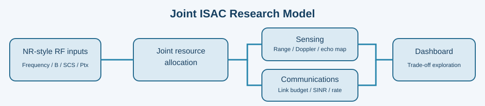

# ISAC Joint Simulator v0.2

Interactive **joint sensing and communications** research demonstration for Converture Market Intelligence. Unlike TrustISAC-Sim, this project does **not** include a trust or anti-spoofing decision layer.



## What you can change

- **RF:** carrier frequency (0.7–52.6 GHz), bandwidth (5–400 MHz), NR-style subcarrier spacing (15/30/60/120/240 kHz), transmit power, antenna gains, receiver noise figure, path-loss exponent, UE distance.
- **Resource allocation:** communication traffic demand, percent of RF resources reserved for sensing, sensing coherent integration time.
- **Target:** object scenario (vehicle, drone, pedestrian), distance, radial velocity, radar cross-section, optional second object, random seed.
- **Time:** frame slider advances a synthetic target trajectory (0.4 s/frame).

The app displays a range–Doppler **likelihood visualization**, measured target range and speed proxies, communications link KPIs, and a sensing/throughput resource allocation curve. A single run can be exported to JSON.

## Run locally

```bash
python3 -m venv .venv
source .venv/bin/activate        # Windows: .venv\\Scripts\\activate
pip install -e '.[dev]'
streamlit run app.py
```

Open the local address shown by Streamlit (usually http://localhost:8501).

## Run tests

```bash
pytest -q
```

## Technical interpretation

| Output | Simplified modeling basis | Important limitation |
|---|---|---|
| Range resolution | c/(2B) | Ideal bandwidth-limited resolution, not guaranteed ranging error |
| Radial speed | f_D λ/2 | Monostatic, constant radial velocity |
| Velocity resolution | λ/(2 T_coherent) | Idealized coherent integration; no ambiguity management |
| Range–Doppler map | Echo Gaussian point-spread functions and noise | **Not** a full OFDM pilot estimator, FFT radar or validated detector |
| Detection visibility | R^-4 echo proxy + synthetic threshold | Not calibrated probability of detection |
| Object type | Scenario truth label | **Not RF object classification** |
| Received power | Log-distance model anchored to FSPL at 1 m | Not a calibrated measurement of 3GPP SS-RSRP |
| SINR | RX signal divided by load-dependent noise+interference | Simplified interference; no frequency-selective channel |
| Throughput | B log2(1+SINR) with bounded efficiency and resource/load factors | Not 3GPP link-level BLER/PHY scheduling result |
| CQI/MCS/BLER/latency | Visualization indicators | Not actual standardized 3GPP table lookups |

**3GPP-aligned, not 3GPP compliant.** Uses NR-like numerology and vocabulary. Full standards conformance would require exact TS 38.211 signal mapping, full PHY/MAC scheduler, reference signal and receiver design, and a 3GPP channel/sensing evaluation setup. 3GPP TR 38.765 (Release 20) is an ISAC *study*; ETSI GR ISC 003 is architecture-oriented pre-standardization work.

**Object identification:** declaring a target to be a vehicle or drone is an *input*, not an inferred type from RF measurements. Robust RF-derived typing needs a much richer signal model, micro-Doppler, angle and target signatures plus validation data.

## Suggested improvements

1. Real CP-OFDM resource-grid and sensing echo generation with PRS/CSI-RS/SRS configurations.
2. 2D FFT range–Doppler estimation and CFAR detector with measurable false alarm probability.
3. Multipath, clutter, beamforming and angle-of-arrival estimation.
4. A clearly labeled machine-learning classifier trained and tested on independently held-out signatures.
5. More faithful NR throughput (TDD slots, MCS tables, transport-block sizes, HARQ) and fading channels.
6. Field-data validation and documented error bars, then commercial calibration.

## Standards references

- [3GPP TR 38.765 — Study on Integrated Sensing And Communication (ISAC) for NR](https://portal.3gpp.org/desktopmodules/Specifications/SpecificationDetails.aspx?specificationId=4446)
- [3GPP TR 22.837 — Study on Integrated Sensing and Communication](https://portal.3gpp.org/desktopmodules/Specifications/SpecificationDetails.aspx?specificationId=4044)
- [ETSI GR ISC 003 — ISAC system and RAN architectures](https://www.etsi.org/newsroom/news/2646-gr-isc-003-6g-isac-system-ran-architectures/)

## License

MIT — see LICENSE. Simulation results must retain assumptions and scope disclosures.

## Publish to a **new** GitHub repository

This project is deliberately separate from `TrustISAC-Sim`.

On a Mac with Git and the GitHub CLI (`brew install gh`), run:

```bash
gh auth login
bash publish_to_github.sh isac-joint-sim
```

The helper creates and pushes a new public repository in your authenticated GitHub account. If `origin` already exists, it pushes the local `main` branch instead. Review the files before publishing publicly.


## v0.2 — Actual OFDM echo FFT and recording

Run `streamlit run app_v02.py` for the upgraded dashboard (the original `app.py` remains available for comparison). The CP-OFDM research waveform uses a random QPSK pilot grid with target-delay phase and Doppler phase imposed on the returns, followed by pilot equalization, a delay IFFT and slow-time Doppler FFT. A heuristic peak picker produces range and radial-velocity estimates; multi-object returns are simulated. Unambiguous range, velocity aliasing, and bandwidth truncation are reported.

Changing frequency, bandwidth, subcarrier spacing, power, receiver noise figure, integration, assumed sensing SNR, target range/velocity/RCS, and sensing allocation updates the experiment. Communications metrics remain independently modeled downlink **proxies**, not PHY transport-block or 3GPP conformance calculations. **No RF object type classifier is implemented**; drone/vehicle/pedestrian names are labeled scenario inputs. The sensing-SNR-at-100m control is a hypothetical calibration assumption, not a measured radar SNR. The time sampling uses a synthetic sensing observation cadence, not an exact 3GPP slot/frame schedule.

The v0.2 app exports JSON, an animated GIF, and an MP4 (MP4 requires FFmpeg on the host). Tests: `pytest -q`. Install with `pip install -e '.[dev]'`.

Standards reference: 3GPP TR 38.765 (Release 20) is a *study* on ISAC for NR; this is a reproducible experimental teaching simulator, not a certified implementation. Simulation outcomes are not evidence of field accuracy or commercial sensing economics.
